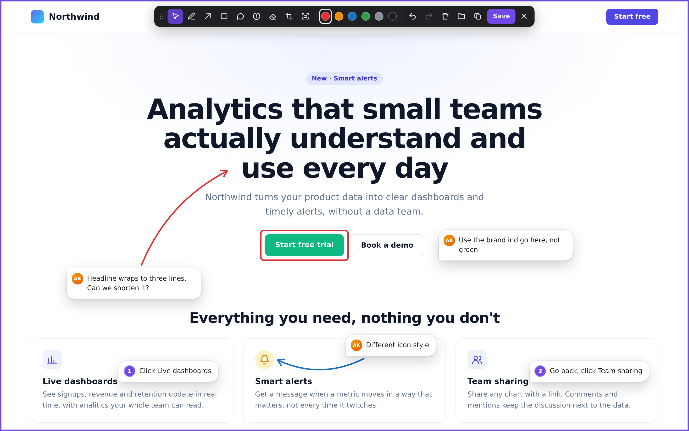
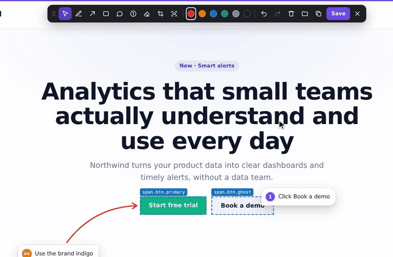

# Page Review

> [!WARNING]
> **Beta.** This is an early prototype and is not recommended for regular use yet.
> Expect rough edges and breaking changes, including to saved reviews.

A Chrome extension for reviewing websites the way you'd mark up a screenshot: draw arrows,
boxes and freehand marks on any page and leave comments on them. Each review is saved as an
annotated screenshot plus a description of every comment and the page element it points at,
ready to paste into an AI agent or a ticket.

## Install

Page Review is coming to the Chrome Web Store. Until then, load it from source: clone this
repo, open `chrome://extensions`, turn on **Developer mode**, click **Load unpacked** and
select the `extension/` folder.

Open any page, click the Page Review icon (or press **Alt+Shift+R**), mark it up and press
**Ctrl/Cmd+S**.

## What you can do

- **Draw** arrows, boxes and freehand marks in six colors; drag, bend and resize them, undo anything.
- **Comment**: finishing an arrow or box opens a comment about its element; **T** adds one anywhere.
- **Steps**: numbered cards for an ordered sequence, such as the clicks that reproduce a bug.
- **Show elements** outlines the element each mark points at, to check it picked the right one.
- **Frame** captures only part of the page.
- **Save and copy**: save the screenshot and comments, or copy the image or Markdown for an agent.
- **Reviews page**: saved reviews by day, each with Copy as image and Copy as Markdown.
- **Combine** 2 to 4 screenshots into one image: Before / After, Expected / Actual and more.

## Working with an agent

**Copy for agent** puts the comments and steps on the clipboard as Markdown, each with its
element's role, text and CSS selector. For more than a one-off, save reviews as files (below) and
give your agent the `SKILL.md` or prompt from **Settings → AI agent**, so it can read them itself.

## Storage

Reviews always stay in the browser; in Settings you can also write each one to a Downloads
folder, or to a local server (`npm run serve` or `npm run mcp`) that saves `~/.page-review/`.

## More

[Privacy policy](PRIVACY.md) · [Keys, how comments find their element, limitations](docs/details.md)

Develop: `npm test`, `npm run screenshots` and `npm run gifs` (README media),
`npm run store-images` and `npm run build:store` (Chrome Web Store images and zip).
